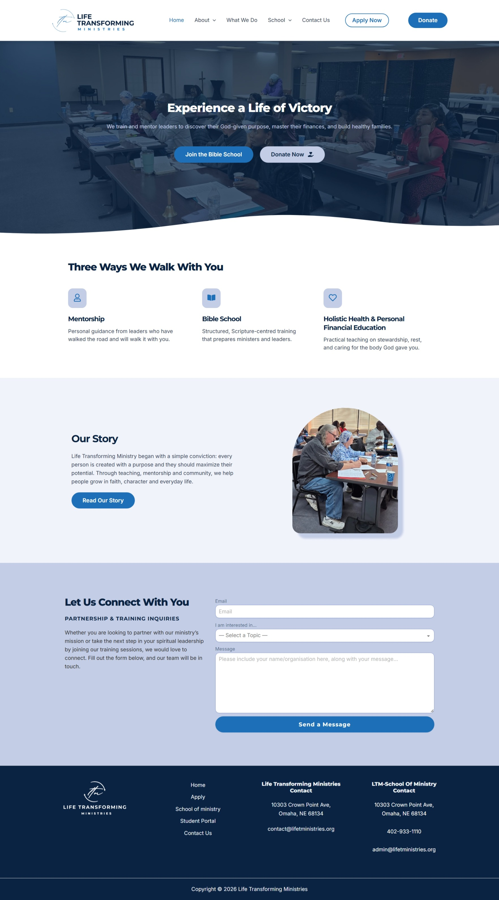
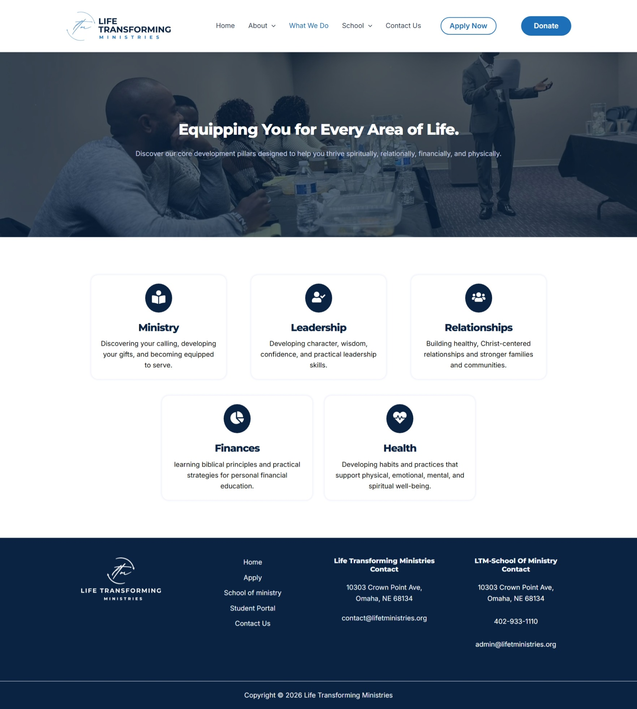
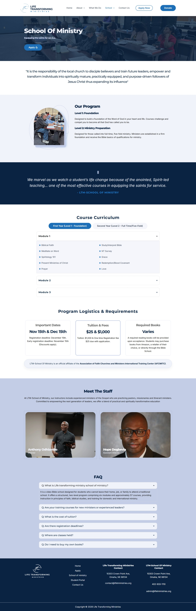
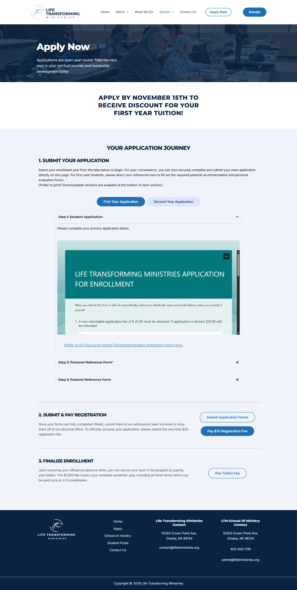
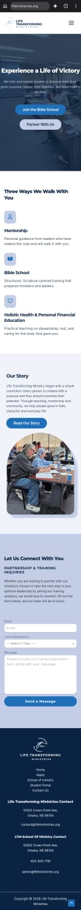

# Life Transforming Ministries (LTM) — Website & Bible School Portal

Official website and digital student application hub for **Life Transforming Ministries (LTM)**. Built on WordPress with a focus on clean design, mobile responsiveness, low maintenance overhead, and seamless Microsoft 365 integration.

---

## 📸 Project Gallery

### Home Page


### What We Do


### School (Desktop)


### Digital Application Hub (Microsoft Forms)


### Mobile Responsiveness


---

##  What the Website Does

The LTM website serves as both the ministry's public digital presence and an operational hub for its Bible School. Visitors can learn about the ministry, explore the multi-year Bible School curriculum, submit partnership or training inquiries, access the student portal, and complete enrollment applications entirely online.

---

##  Key Features

- **8-Page Responsive Architecture:** Complete ministry website with structured Header/Footer navigation and consistent brand styling across desktop, tablet, and mobile.
- **Digital-First, Print-Fallback Application Hub:** Replaced manual print-scan-email workflows with an interactive tabbed application system:
  - **First Year Application:** Organized into 3 clear steps (Student Application, Personal Reference, and Pastoral Reference) using embedded Microsoft Forms.
  - **Second Year Application:** Dedicated tab with a direct embedded Microsoft Form.
  - **Print Fallback:** Subtle secondary download links for printable ZIP application packets for applicants with limited internet access.
- **Microsoft 365 & SharePoint Integration:** Native links to the organization's SharePoint Student Portal from the header and footer, eliminating the security and maintenance overhead of a custom WordPress login system.
- **Interactive Course Curriculum:** Tabbed and accordion-based module breakdown for Year 1 and Year 2 courses.
- **Partnership & Training Inquiry Form:** Direct lead-capture funnel on the Home page for ministry partners and training inquiries.
- **Hardened Security & Maintenance:** Protected backend login using a custom URL (`WPS Hide Login`) to block automated bot attacks, paired with scheduled automated cloud backups (`UpdraftPlus`).

---

##  Tech Stack

- **CMS:** WordPress
- **Page Builder:** Elementor (Free) & Royal Elementor Addons
- **Ecosystem Integrations:** Microsoft 365 (Microsoft Forms, SharePoint)
- **Security & Backups:** WPS Hide Login, UpdraftPlus
- **Customizations:** Custom HTML (`<iframe>` responsive overrides) & CSS typography adjustments

---

##  Technical Challenges & Solutions

- **Bypassing Free-Tier Form Limits:** The free form builder capped forms at 3 fields. To keep the `Reply-To` email functionality intact without requiring a paid upgrade, the Home page inquiry form was engineered using 3 fields (Email, Topic Dropdown, and Message) with a structured fill-in-the-blank placeholder guiding users to include their name.
- **Android Mobile Text Overlap Fix:** Resolved a device-specific text-wrapping collision on Android screens (e.g., Samsung Galaxy S24+) within the Course Curriculum accordions by converting fixed pixel line heights to relative `EM` units (`1.5em–1.6em`) and adjusting list item spacing.
- **Responsive Microsoft Form Embeds:** Overrode Microsoft Forms' default `max-height: 100vh` and fixed `640px` width constraints inside hidden accordion containers by applying `width="100%"` and explicit `min-height` inline styles so forms render cleanly across all screen sizes.

---

## 📂 Repository Structure

```text
├── assets/
│   ├── Home.jpeg
│   ├── What-we-do.jpeg
│   ├── School.jpeg
|   ├── Apply.jpeg 
│   └── mobile-view.png
└── README.md
